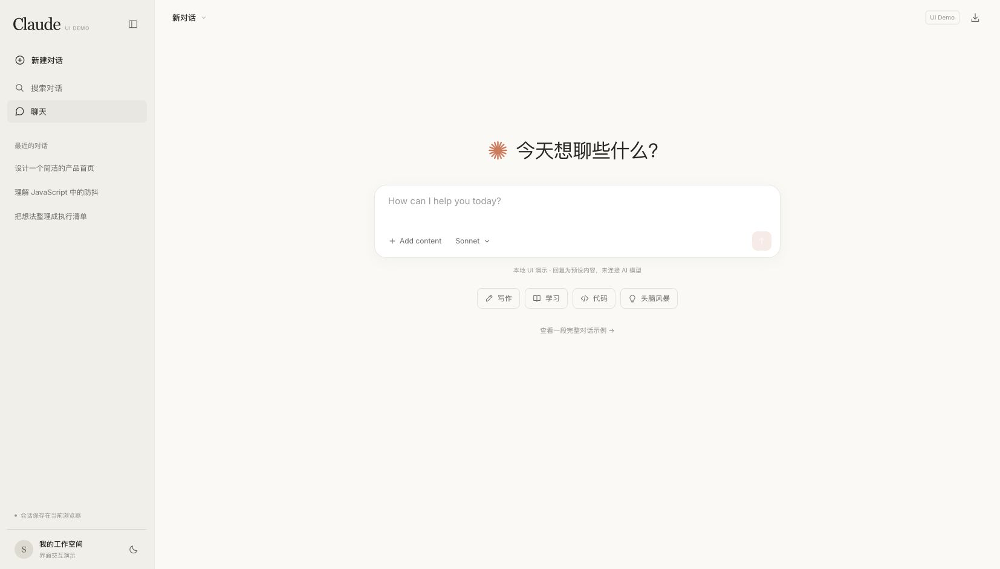
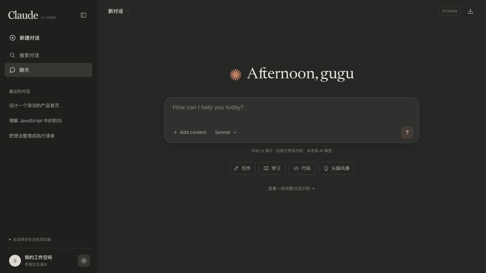
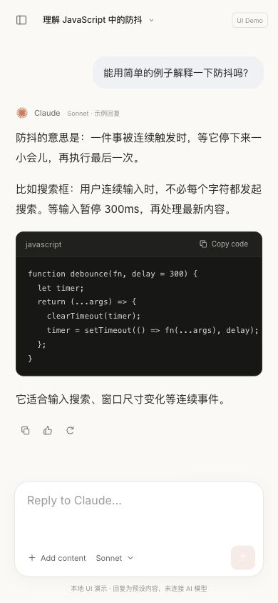

# Claude Web Design Reference

**一套带完整聊天实例的 Claude 风格网页设计参考。下载就能看，复制就能改，也可以直接交给 Agent。**

v3 将实际运行并经使用者认可的聊天界面作为默认起点：暖白画布、灰米色侧栏、Inter 字体、轻边框、黏土橙发送按钮，以及完整的消息与输入操作。配色、尺寸、源码、字体和接手说明都在仓库里。

**完整聊天实例 · 浅色 / 深色 · 手机抽屉导航 · 本地字体 · 无 npm 依赖 · Agent 单文件指南**

[看效果](#实际效果) · [运行实例](#下载运行) · [交给 Agent](#交给-agent) · [按需取用](#按需取用) · [修改与验证](#修改与验证)

## 实际效果

下面是 `examples/claude-chat/` 实际运行的截图。首页与对话页属于同一个实例。

**浅色首页**：会话导航、居中的输入框、模型选择、附件入口和快捷提示。



**深色对话**：用户消息、助手正文、代码块、消息操作和底部输入框。



<details>
<summary>查看 390px 手机聊天效果</summary>



</details>

截图来自本项目实例，状态可能包含演示交互；不是 Claude 官方产品截图。仓库不依赖有时限的临时预览链接。

## 现在能用什么

| 能力 | 实例里已接好的行为 |
| --- | --- |
| 会话管理 | 新建、切换、搜索、重命名；保存在当前浏览器；导出 Markdown |
| 输入与发送 | 输入框自动增高，Enter 发送、Shift+Enter 换行，组合输入保护，生成期间保留新草稿 |
| 模型与思考 | Sonnet / Opus / Haiku 选择菜单，Extended thinking 开关，思考过程折叠 |
| 消息显示 | 预设回复逐步显示、停止生成、重新生成示例、代码块与复制、回复复制、有帮助标记 |
| 附件 | 添加示例资料或读取本地 txt / md / json，最多 3 个、每个 100 KB |
| 页面适配 | 浅深主题、桌面收起侧栏、手机抽屉导航、长中文和窄屏排版 |

**这是可以操作的前端实例。** 模型菜单不会调用真实模型；回复来自本地预设；附件文本和会话保存在当前浏览器，没有账号、服务器上传或多设备同步。

## 下载运行

### 只想直接看效果

打开 **[单文件实例 standalone.html](./examples/claude-chat/standalone.html)**，选择 **Download raw file** 下载后用浏览器打开。样式、脚本、图标和 Inter 字体已经内嵌，断网也能显示。

浏览器对 `file://` 的复制和持久化支持不一致；需要完整测试这些操作时，用下面的本地服务器方式。

### 想修改实例

下载整个仓库，或者克隆到本机。在仓库根目录执行：

```sh
python3 -m http.server 8080 --bind 127.0.0.1
```

然后打开 [本地聊天实例](http://127.0.0.1:8080/examples/claude-chat/)。不需要 `npm install`，也不需要 API Key。

只需复制整个 [`examples/claude-chat/`](./examples/claude-chat/) 目录，就能作为独立静态项目继续开发。`index.html` 与 `assets/` 是可编辑源码；`standalone.html` 是生成的便携版。

## 交给 Agent

**能读取仓库的 Agent**：先读 [AGENTS.md](./AGENTS.md)。它会找到已认可的实例、准确的文件职责、两套参考的适用范围和验证方法，不依赖某一家 Agent 的专用接口。

**只能发一个附件时**：下载 **[Claude网页设计参考_v3_Agent.md](./Claude网页设计参考_v3_Agent.md)**。它先解释如何使用，再给出设计规则、接入位置和完整的文本源码，可独立重建界面。二进制字体不塞进文本上下文；要与截图使用同一套 Inter，复制示例里的 `assets/fonts/`。没有字体文件时可用系统回退。

可以直接复制这段任务说明：

```text
请读取这个仓库的 AGENTS.md，以 examples/claude-chat/ 的已认可实例为视觉起点。
先运行现有实例，再根据我的需求修改内容与功能。保留现有技术栈。
保持它的配色、字体层级、侧栏和阅读列比例、输入框与消息样式，
不要重新设计成卡片仪表盘，也不要混用旧版手册的布局尺寸。
明确标注模拟行为；只有真正接好后端后才能称为真实功能。
完成后检查桌面浅深主题、390px 布局、输入与草稿、会话搜索和代码复制。

我的需求是：……
```

这个实例也可以迁移到 React / Vue：沿用目标项目结构，拆分导航、输入框、消息和对话框；保留视觉比例与行为，不需要照搬原生 DOM 渲染方式。详细说明见 [实例 README](./examples/claude-chat/README.md)。

## 按需取用

| 你需要什么 | 直接使用 |
| --- | --- |
| 做出截图中的聊天界面 | [`examples/claude-chat/`](./examples/claude-chat/) |
| 只下载一个可运行文件 | [`standalone.html`](./examples/claude-chat/standalone.html) |
| 给 Agent 完整文本上下文 | [v3 单文件指南](./Claude网页设计参考_v3_Agent.md) |
| 查询实例的实际颜色和尺寸 | [`chat-profile.json`](./chat-profile.json)、[chat.css](./examples/claude-chat/assets/chat.css) |
| 在现有页面中使用通用表单组件 | [v2 CSS](./claude-reference.css)、[交互手册](./Claude网页设计参考_v2.html) |
| 复用输入、弹窗、滚动跟随等工具 | [interaction-examples.js](./interaction-examples.js)、[API 说明](./INTERACTION_API.txt) |
| 查看原始 Figma 标注和整合取舍 | [tokens.json](./tokens.json)、[INTEGRATION_DECISIONS.json](./INTEGRATION_DECISIONS.json) |

**两套参考有明确边界。** v3 聊天实例是本次认可的视觉起点，采用 Inter、256px 桌面侧栏、672px 首页输入框和黏土橙图标发送按钮；v2 保留通用 `.cr-*` 组件、近黑文字主按钮、两档密度，以及原始 Figma 颜色登记。它们共用交互工具，但布局与视觉参数不能互相覆盖。v3 实例没有密度切换。

## 设计参数速览

| 项目 | 聊天实例采用值 |
| --- | --- |
| 浅色表面 | 页面 `#faf9f6`，侧栏 `#f0efea`，输入框 `#ffffff` |
| 深色表面 | 页面 `#262624`，侧栏 `#1f1f1d`，输入框 `#30302e` |
| 强调色 | `#d97757`，用于小面积符号和图标发送按钮 |
| 字体 | 本地 Inter 400 / 500 / 600；中文使用系统回退 |
| 布局 | 桌面侧栏 256px；首页输入框最大 672px；会话内容宽度最大 704px |
| 排版 | 首页标题 32px；助手正文 15px / 1.8；手机输入 16px |
| 圆角 | 输入框 20px；用户消息 18px；代码块 11px；弹窗 14px |
| 手机布局 | 760px 以下使用侧栏抽屉；390px 布局已有预览验证 |

这些是**本实例的实现值**，不等于 Claude 的完整官方规范。实例保留了紧凑控件；它不继承 v2 的“触控目标至少 44px”验证结论。实际产品应按目标设备补充触控、键盘和对比度验收。

## 修改与验证

改样式、页面或聊天逻辑后，重新生成单文件交付，再运行检查：

```sh
python3 scripts/build-deliverables.py
python3 scripts/verify-package.py
```

检查包含：文件引用与字体、分发文件与源码同步、源代码语法、7 个交互 API 对应的 **11 组状态测试**、单文件内嵌资源和 SHA-256 清单。页面视觉和真实操作仍要在浏览器核验；见 [实例验证记录](./examples/claude-chat/VALIDATION.md)。

不要直接修改生成的 `standalone.html` 或 v3 指南代码块。修改 `examples/claude-chat/` 中的源码和 `docs/agent-guide-intro.md`，再执行生成脚本。共享交互工具以根目录 `interaction-examples.js` 为准。

## 来源与许可

- [用户提供的 CDS Storybook](https://claude-storybook.bystanderss.chatgpt.site/)：v3 聊天实例的视觉参照。
- [MCP Apps for Claude Community UI kit](https://www.figma.com/design/RBi8VghMgGaJoJuNCbe2s6/MCP-Apps-for-Claude--Community-?node-id=0-1)：保留在 v2 中的颜色、排版和组件标注参考。
- [Caho1/open-claude-ui](https://github.com/Caho1/open-claude-ui/tree/f4947c62a459f6413ed44b289a8d495962add1a2)：组件结构与交互模式参考，固定提交 `f4947c6`；[上游许可](./UPSTREAM_LICENSE.txt)。
- [Inter](https://github.com/rsms/inter)：本实例附带的开源字体；[SIL Open Font License](./examples/claude-chat/assets/fonts/OFL.txt)。

本项目是非官方设计参考。Claude 名称与示意符号用于说明参考对象，不代表 Anthropic 授权或合作。未附带 Anthropic 专有字体、官方 Logo 文件或生产样式源码。第三方许可只覆盖对应材料，不能自动套到 Figma 截图和整份参考。
