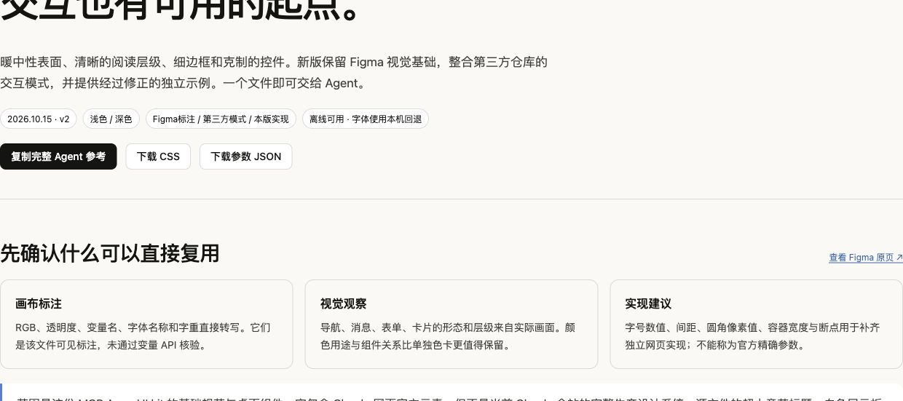

# Claude Web Design Reference

**用统一的视觉和交互规则，搭建 Claude 风格的聊天页、知识库和工具工作台。**

这是一套可以直接复用的网页设计参考：有配色与布局规则、现成 CSS、7 个原生 JavaScript 交互工具，还有一份包含完整代码的 Agent 指南。你可以自己接入项目，也可以让 AI 开发助手按照这些规则实现页面。

**浅色 / 深色主题 · 舒适 / 紧凑密度 · 离线交互手册 · CSS / JS 无外部包依赖**

[效果预览](#效果预览) · [功能一览](#功能一览) · [快速开始](#快速开始) · [Agent 接入](#agent-接入) · [API 说明](./INTERACTION_API.txt)

| 如果你是…… | 从这里开始 |
| --- | --- |
| 想看看能做什么的人 | 看下面的截图和功能清单，再下载 [交互手册](./Claude网页设计参考_v2.html) |
| 想让 AI 帮忙做网页的人 | 下载 [Agent 单文件指南](./Claude网页设计参考_v2_Agent.txt)，和需求一起发送 |
| 已经有项目的开发者 | 复制 [CSS](./claude-reference.css)，按需引入 [交互 JS](./interaction-examples.js) |
| 正在读取这个仓库的 Agent | 先读 [AGENTS.md](./AGENTS.md)，再按任务加载指南、样式或 API |

## 效果预览

**按钮、选择控件、输入框与应用卡片** — 下图是本项目实际运行的样式。



**深色聊天布局** — 侧边导航、阅读区、用户消息和输入栏共用一套主题变量。


想亲手试用？打开 [HTML 手册文件](./Claude网页设计参考_v2.html)，选择 **Download raw file** 下载，再用浏览器打开。里面可以切换主题与密度，操作弹窗、键盘工具栏、句中替换和模拟流式输出。下载后可离线使用。

## 功能一览

| 你想做的事情 | 已有的可复用内容 | 使用入口 |
| --- | --- | --- |
| 让整站配色与排版统一 | 浅深色变量、文字层级、间距、圆角、轻阴影与状态色 | [CSS](./claude-reference.css) / [参数 JSON](./tokens.json) |
| 组合表单与工作台 | 默认描边、主操作、次操作、透明、强调、危险共 6 种按钮样式；输入框、文本域、开关、单选、复选、卡片与导航样式 | CSS 中的 `.cr-*` 类 |
| 同时照顾阅读和密集操作 | 舒适 / 紧凑两档密度；窄屏与粗指针下扩大操作目标 | `data-density` |
| 做一个好用的聊天输入栏 | 自动高度、Enter 发送、Shift+Enter 换行、组合输入保护、异步重复提交拦截 | `bindComposer()` |
| 避免弹窗打开后焦点乱跑 | 原生模态框、初始焦点、Tab 循环、Escape 关闭及焦点恢复 | `bindDialog()` |
| 让流式回复尊重阅读位置 | 用户向上阅读时停止追尾；点击“跳到最新”后恢复 | `createScrollPinning()` 状态逻辑 |
| 为 `@` / `/` 建议菜单打基础 | 检测光标前的触发词，按范围替换，保留句中后缀并拒绝过期文本 | `findSuggestionTrigger()` + `replaceSuggestion()` |
| 给工具栏或网格加键盘导航 | Home / End、方向键、首尾回绕、RTL 与网格列步长 | `nextRovingIndex()` 索引逻辑 |
| 让卡片内的工具栏适配窄空间 | 根据容器宽度隐藏可选提示、换行，并保留主要操作 | `.cr-toolbar-container` |

样式可以直接引用；输入栏和弹窗提供 DOM 绑定；滚动、候选范围与焦点索引提供逻辑函数，需要接上你自己的界面和数据。交互代码集中在 [interaction-examples.js](./interaction-examples.js)。

## 快速开始

### 1. 让 Agent 帮你做网页

下载 **[Claude网页设计参考_v2_Agent.txt](./Claude网页设计参考_v2_Agent.txt)**，和需求一起发送：

```text
请参考附带的设计指南，为我做一个个人知识库网页。

需要：左侧分类导航、笔记列表、正文阅读区和搜索框。
默认浅色主题，提供深色切换；正文采用舒适密度。
复用指南里的样式与适用的交互逻辑，保留我现有的技术栈。
完成后检查手机布局、键盘焦点和长中文内容。
```

这一个文件已经包含规则、完整 CSS / JS、API 说明与来源，不必再把仓库文件逐个上传。它也适合用来改造已有页面的视觉风格。

### 2. 在现有项目中使用样式

将 [claude-reference.css](./claude-reference.css) 放进项目，给页面设置主题和密度，再组合 `.cr-*` 类：

```html
<!doctype html>
<html lang="zh-CN" data-theme="light" data-density="comfortable">
  <head>
    <meta charset="utf-8">
    <meta name="viewport" content="width=device-width, initial-scale=1">
    <link rel="stylesheet" href="claude-reference.css">
    <title>我的知识库</title>
  </head>
  <body class="claude-ref">
    <main class="cr-main">
      <div class="cr-reading">
        <article class="cr-card">
          <h1>我的知识库</h1>
          <p>在统一的阅读界面里整理想法。</p>
          <button class="cr-btn cr-btn--primary">新建笔记</button>
          <button class="cr-btn cr-btn--ghost">查看全部</button>
        </article>
      </div>
    </main>
  </body>
</html>
```

改成 `data-theme="dark"` 即可切换深色；改成 `data-density="compact"` 可获得更紧凑的控件和间距。阅读正文与输入字号不会随密度一起缩小。

### 3. 给输入栏加上交互

引入 [interaction-examples.js](./interaction-examples.js)，使用 `window.ClaudeRefV2`。下面的示例沿用上一步的 CSS，在本地接收并显示输入：

```html
<form id="composer" class="cr-composer">
  <label for="draft">写下你的想法</label>
  <textarea id="draft" placeholder="Enter 发送，Shift+Enter 换行"></textarea>
  <button class="cr-btn cr-btn--primary" type="submit">发送</button>
</form>
<p id="result" role="status"></p>

<script src="interaction-examples.js"></script>
<script>
  const form = document.querySelector('#composer');
  const composer = ClaudeRefV2.bindComposer(
    document.querySelector('#draft'),
    async (text) => {
      // 替换成你的提交逻辑；此示例只在本地显示文本。
      document.querySelector('#result').textContent = text;
    }
  );

  form.addEventListener('submit', (event) => {
    event.preventDefault();
    void composer.submit();
  });

  // 组件卸载时调用 composer.dispose() 清理监听。
</script>
```

原生页面可以直接使用。React / Vue 项目可在组件挂载时绑定，在卸载时调用 `dispose()`；纯状态函数也可以用于自己的 Hook / composable。无需为了使用这份参考而更换现有技术栈。

## Agent 接入

**能读取仓库的 Agent：**从 [AGENTS.md](./AGENTS.md) 开始，按下面的文件职责选择要读取的内容。支持该约定的工具可能自动加载它；其他工具可由用户明确指定读取。

**只能接收附件或文本的 Agent：**读取 [单文件指南](./Claude网页设计参考_v2_Agent.txt) 即可，文件内包含完整代码，无需额外下载依赖。

给能访问仓库的 Agent 的任务提示词：

```text
请先读取本仓库的 AGENTS.md，再按本次任务需要读取设计指南与 API。
复用现有 CSS 和适用的交互函数，保持项目已有技术栈。
明确哪些是直接可用的样式、哪些逻辑仍需接入业务。
我的网页需求是：……
```

| Agent 需要解决什么 | 读取哪个文件 |
| --- | --- |
| 理解任务边界、执行顺序和验收要求 | [AGENTS.md](./AGENTS.md) |
| 获取完整设计规则与可复制代码 | [单文件指南](./Claude网页设计参考_v2_Agent.txt) |
| 直接引用样式或接入交互 | [claude-reference.css](./claude-reference.css) / [interaction-examples.js](./interaction-examples.js) |
| 查 API 参数、返回值和清理方式 | [INTERACTION_API.txt](./INTERACTION_API.txt) |
| 读取结构化参数或追溯设计取舍 | [tokens.json](./tokens.json) / [整合决策](./INTEGRATION_DECISIONS.json) |
| 确认可验证范围 | [测试结果](./TEST_RESULTS.txt) / [浏览器记录](./VERIFICATION.json) |

## 设计规则速览

| 维度 | 默认方案 |
| --- | --- |
| 表面与文字 | 暖白页面、灰米色次表面、近黑文字；提供对应深色变量 |
| 操作层级 | 近黑主按钮、浅填充次按钮、陶土强调与红色危险操作 |
| 密度 | 普通按钮 36px，紧凑模式 32px；窄屏或粗指针目标至少 44px |
| 排版 | 正文与输入 16px，UI 14px；动态数字等宽对齐 |
| 组件圆角 | 控件 8px、卡片 12px、弹窗 16px、消息 18px、输入区 20px |
| 响应式 | 页面断点与组件容器查询配合，保留主要操作 |
| 动效 | 少量统一时长与缓动，支持减弱动效设置 |

配色登记来自 Figma 可见标注；组件尺寸与交互参数中包含本项目的实现建议。37 个颜色变量、12 项整合决策和各自来源记录在 [tokens.json](./tokens.json) 与 [INTEGRATION_DECISIONS.json](./INTEGRATION_DECISIONS.json) 中。

## 交互工具索引

| API | 负责什么 |
| --- | --- |
| `bindComposer()` | textarea 自动高度、提交、组合输入保护、异步状态和监听清理 |
| `createCompositionGuard()` | 在自定义输入组件中单独判断是否允许发送 |
| `findSuggestionTrigger()` | 返回光标前 `@` / `/` 触发词及其范围 |
| `replaceSuggestion()` | 只替换指定范围，保留左右文字，拒绝过期快照 |
| `createScrollPinning()` | 管理追尾、用户阅读、冷却时间和跳到最新的状态 |
| `nextRovingIndex()` | 计算一维或网格导航的下一个焦点索引 |
| `bindDialog()` | 绑定原生 dialog 的初始焦点、Tab 边界和关闭恢复 |

完整签名见 [INTERACTION_API.txt](./INTERACTION_API.txt)。候选菜单的数据源、滚动事件接线与业务请求由使用方按项目实现。

## 验证与使用范围

无需安装依赖，使用 Node.js 运行：

```sh
node interaction-tests.cjs
```

当前版本通过 **11 组状态与选择逻辑测试**。浏览器核验覆盖浅深色、两档密度、390px 布局、输入提交与换行、弹窗焦点、句中替换、键盘回绕和模拟流式阅读。详细记录见 [TEST_RESULTS.txt](./TEST_RESULTS.txt) 与 [VERIFICATION.json](./VERIFICATION.json)。

本项目提供前端样式、交互工具和参考页面。模型调用、真实上传、数据存储与完整应用业务由项目接入。真实系统输入法、屏幕阅读器和触屏行为仍需在目标环境测试；8 个尚待核对的 Figma 语义色保留标记，不作为已确认值输出。

## 来源与致谢

- **[MCP Apps for Claude Community UI kit](https://www.figma.com/design/RBi8VghMgGaJoJuNCbe2s6/MCP-Apps-for-Claude--Community-?node-id=0-1)**：配色、字体层级及桌面网页组件的视觉参考。
- **[Caho1/open-claude-ui](https://github.com/Caho1/open-claude-ui/tree/f4947c62a459f6413ed44b289a8d495962add1a2)**：组件结构与交互模式参考，固定到提交 `f4947c6`。

交互函数由本项目独立编写，并修正了输入保护、句中替换与焦点管理等接入细节。原始标注、第三方代码与本项目建议分别记录，便于后续调整和核对。

本项目非 Anthropic 官方项目，不附带品牌字体、Logo 或音频文件。上游许可保留在 [UPSTREAM_LICENSE.txt](./UPSTREAM_LICENSE.txt)；该声明对应上游材料，不代表 Figma 截图或整份参考自动采用相同许可。
