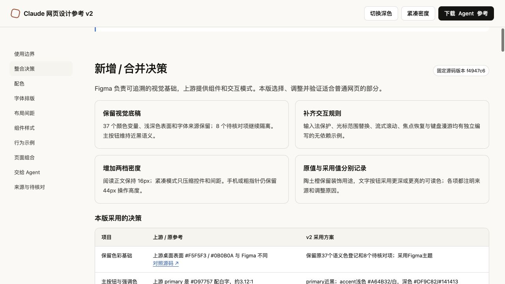

# Claude Web Design Reference v2

可直接交给 Agent 的 Claude 风格网页设计与交互参考。以 Figma 的 MCP Apps UI kit v1.1 为视觉基础，吸收 `open-claude-ui` 固定提交中的交互模式，并提供独立编写、修正过的无依赖示例。

## 从这里开始

- **[Agent 单文件参考](./Claude网页设计参考_v2_Agent.txt)**：包含说明、规则、来源、完整 CSS 和 JavaScript。下载这一个文件，与网页需求一起发给 Agent 即可。
- **[可视化手册 HTML](./Claude网页设计参考_v2.html)**：下载到本地后用浏览器打开；支持浅深色、舒适/紧凑密度及交互演示。GitHub 文件页不会直接执行 HTML。
- **[CSS](./claude-reference.css)**、**[交互 JavaScript](./interaction-examples.js)**、**[参数 JSON](./tokens.json)**：需要接入代码时分别使用。

> 请按照附带的 v2 参考实现网页。默认使用舒适密度，根据实际功能接入交互示例。我的需求是：……



## 包含什么

- 37 个原 Figma 颜色变量及浅深色语义；8 个尚待核对的变量继续隔离。
- 字体、间距、两档密度、语义圆角、组件状态、容器查询与可读强调色。
- 中文组合输入保护、光标范围替换、流式滚动、键盘漫游及原生弹窗绑定。
- 12 项有来源与理由的整合决策、原始截图、验证记录和上游许可。

来源分为 `canvas_annotation`、`visual_observation`、`upstream_code` 和 `implementation_recommendation`。这是参考实现，不是 Anthropic 官方完整设计系统或当前 Claude 全站生产 CSS。

## 本地查看与测试

直接打开 `Claude网页设计参考_v2.html` 即可查看自包含手册。也可以在目录里运行：

```sh
python3 -m http.server 8080 --bind 127.0.0.1
```

随后打开本机 `http://127.0.0.1:8080/`，选择 HTML 文件。纯状态与选择合同测试使用 Node.js，无需安装依赖：

```sh
node interaction-tests.cjs
```

11 组测试已通过。浏览器核验涵盖浅深色、36/32/44px 密度适配、390px 手机布局、Enter 与换行、弹窗焦点、句中替换、方向键回绕和模拟流式阅读。详细范围见 [VERIFICATION.json](./VERIFICATION.json) 与 [TEST_RESULTS.txt](./TEST_RESULTS.txt)。

真实系统输入法、屏幕阅读器、触屏手势及生产业务集成仍需目标环境测试。候选菜单的数据源、完整拖拽分栏、模型调用、上传后端、Electron、音频与 iframe 执行系统不包含在此通用参考中。

## 接入约定

```html
<html lang="zh-CN" data-theme="light" data-density="comfortable">
  <head>
    <link rel="stylesheet" href="claude-reference.css">
  </head>
  <body class="claude-ref">
    <main class="cr-main">
      <div class="cr-reading">
        <button class="cr-btn cr-btn--primary">主要操作</button>
      </div>
    </main>
    <script src="interaction-examples.js"></script>
  </body>
</html>
```

主题只使用 `data-theme="light|dark"`，密度只使用 `data-density="comfortable|compact"`。JS API 位于 `window.ClaudeRefV2`，完整签名与边界见 [INTERACTION_API.txt](./INTERACTION_API.txt)。

## 来源与归属

- Figma：[MCP Apps for Claude Community](https://www.figma.com/design/RBi8VghMgGaJoJuNCbe2s6/MCP-Apps-for-Claude--Community-?node-id=0-1)，提取于 2026-10-14。
- 第三方参考：[Caho1/open-claude-ui](https://github.com/Caho1/open-claude-ui/tree/f4947c62a459f6413ed44b289a8d495962add1a2)，固定提交 `f4947c62a459f6413ed44b289a8d495962add1a2`。
- 整合与验证日期：2026-10-15。

交互函数由本项目独立编写，借鉴公开交互模式；不附带 Anthropic 品牌字体、Logo 或音频文件。上游 MIT 声明保留在 [UPSTREAM_LICENSE.txt](./UPSTREAM_LICENSE.txt)，它说明上游材料的许可，不把原 Figma 截图或整份参考自动重新许可为 MIT。
